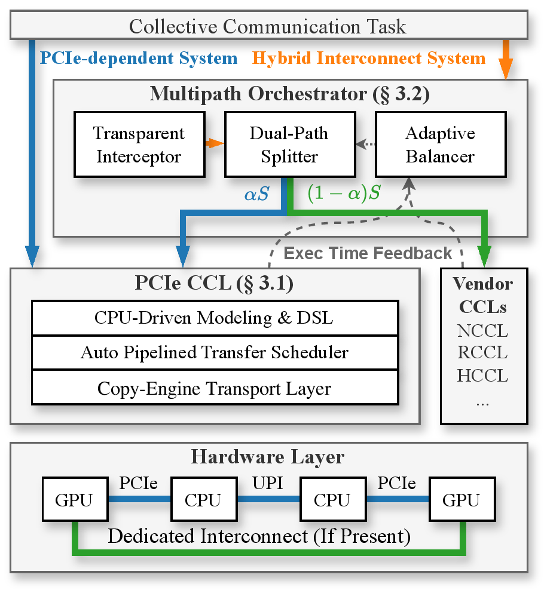

<p align="center">
    <h1 align="center">HyLink</h1>
</p>
<p align="center">
    A two-layer collective communication framework that unlocks underutilized PCIe bandwidth and jointly harnesses dedicated interconnects and the PCIe bus.
</p>

<p align="center">
    
</p>

## Features

- 💡 **PCIe CCL** accelerates collective communication on the PCIe path by making the CPU-rooted PCIe hierarchy explicit and treating NUMA-local host memory as an active routing point, powered by a CPU-driven DSL for topology-aware schedules and an auto-pipelined runtime built on GPU copy engines.
- 🔀 **Multipath Orchestrator** splits each collective across the dedicated link (via the vendor CCL) and the PCIe path (via PCIe CCL) on independent streams with a fork–join model, and a feedback-driven adaptive balancer retunes the split ratio at runtime to keep the two paths balanced under PCIe interference.

## Usage

See each component's README for build and usage instructions:

- [PCIe CCL — CUDA](pcie-ccl-cuda/README.md): PCIe CCL for NVIDIA CUDA.
- [PCIe CCL — Ascend](pcie-ccl-ascend/README.md): PCIe CCL for Huawei Ascend CANN.
- [Multipath Orchestrator](multipath-orchestrator/README.md): Multipath Orchestrator for Huawei Ascend CANN.

## Cite

Your citations are greatly appreciated. 🥰

- ACM Reference
    > Yuezheng Liu, Menghao Zhang, Xuebin Song, Juner Shen, Chunming Hu, and Xudong Liu. 2026. Towards High-Throughput Collective Communication via Harnessing PCIe and Dedicated Interconnects. In Proceedings of the 2026 ACM SIGOPS Annual Technical Conference (ATC 2026).
- Bibtex
    ```bibtex
    @inproceedings{hylink2026,
        author    = {Liu, Yuezheng and Zhang, Menghao and Song, Xuebin and Shen, Juner and Hu, Chunming and Liu, Xudong},
        title     = {Towards High-Throughput Collective Communication via Harnessing PCIe and Dedicated Interconnects},
        year      = {2026},
        booktitle = {Proceedings of the 2026 ACM SIGOPS Annual Technical Conference},
        series    = {ATC 2026}
    }
    ```
